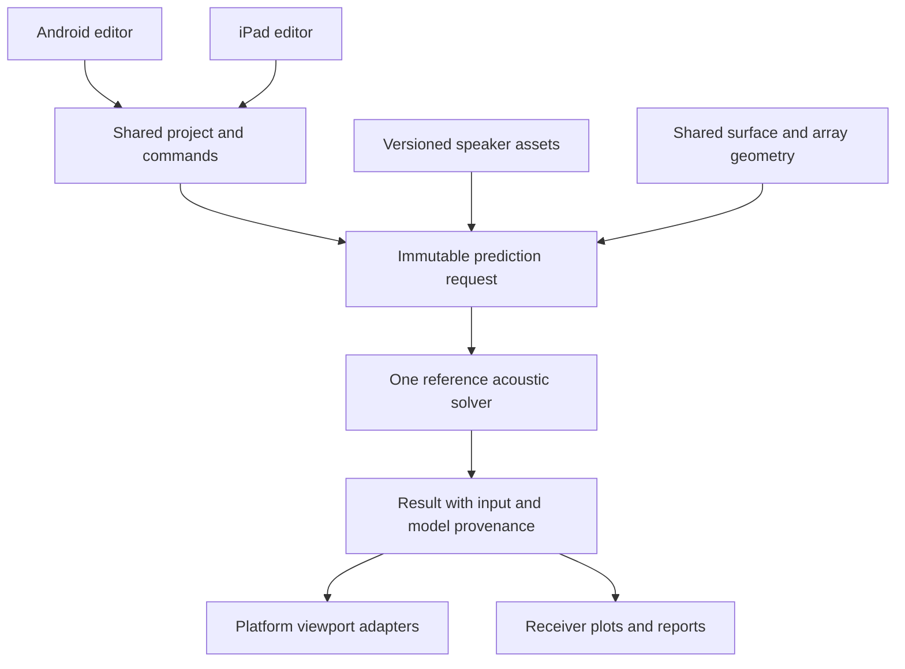

# DroidAcoustic Pro implementation plan

Updated **2026-11-26** after the [project review](project_review.md). This replaces
the original numbered-phase timetable in the README. The first release priority
is **live sound: PA coverage, arrays, subwoofers and delay systems**. The existing
application is Android-only; an iPad path is included as a recommended extension
following the platform review. The progress entries record implemented work; milestone lists also include outstanding release gates.

## Validation-first release sequence (supersedes earlier milestone ordering)

The first dependable release remains a live-sound design tool. Existing feature progress below
records implementation, not manufacturer equivalence or field accuracy. The older M0–M9 gates
remain a backlog; execute the following sequence before expanding room-acoustic features.

1. **V0 — Truthful model and controls (first cleanup batch).** Stop hidden legacy room-reflection
   jobs and inferred-room RT60/intelligibility publication. Replace inactive reflection-order choices
   with the actual first-order capability; describe receiver-grid spacing accurately. Hide global
   wall/ceiling absorption controls that do not affect coverage. Preserve old project fields without
   treating them as active physics. Publish one shared model-scope contract in Android and reports.
   Disable the legacy optimizer, whose approximate objective ignores delay, until replaced/validated.
   Exit: focused regressions for successful predictions, absent unsupported metrics, old-project
   reopen with identical levels and optimizer DSP isolation; Android build and iOS-core compile.
2. **V1 — Reproducible numerical validation pack (baseline implemented; see revision 1 below).** Version fixtures and reference implementations
   for inverse-square propagation, phase/delay/polarity, bandwidth integration, analytic ideal-ground
   interference and arrays. Retain scripts, raw results, tolerances and convergence checks. Add finite
   reflector and barrier cases that expose the current clipped-image and binary-shadow limitations;
   do not claim a universal frequency cutoff. Separate numerical verification from physical validation.
3. **V2 — Speaker-data and external-validation gate (provenance/data consistency and first real angular holdout implemented; external acceptance pending).** Inventory generic estimates, user imports and
   manufacturer-supplied assets separately. Verify calibration, phase reference, operating preset,
   distance and angular coverage. Match manufacturer exports and controlled measurements under
   identical settings; retain permission/provenance and error reports. Qualify near-field/array use
   explicitly rather than assuming isolated-cabinet data covers every arrangement. Define and justify
   acceptance tolerances per use case before claiming professional prediction accuracy.
4. **V3 — Output capability and dependable workflows.** Add frequency-dependent maximum-output /
   headroom only with documented amplifier/DSP, duration, crest-factor and compression/limiting
   assumptions. Validate aiming, sub/delay alignment, coverage reports and restore workflows. Replace
   optimizer objectives with shared-engine calculations before re-enabling automatic application.
   Require practical OnePlus latency/memory results for each supported calculation mode.
5. **V4 — Bounded extensions after validation.** Keep existing reflection/scattering features
   experimental and pause expansion. Gate phase-aware edge diffraction, finite-reflector transitions
   and ground impedance independently, with interference and double-counting references. An ISO
   attenuation approximation must be identified separately from a complex transfer-function model.
   Full-venue 4/8 kHz diffuse coverage remains unqualified; budget failures are not completed results.

Mechanical geometry/splay assistance and iPad rendering feasibility may proceed without certified
rigging claims. Certified loads require a separate manufacturer/hardware/engineering validation
track. Preserve the platform-independent core throughout; do not move physics back into Android.

## Immediate priorities after the November review

1. **Maintain the source-control checkpoint.** This main-branch checkpoint records the shared
   core, Android integration, validated fixes and retained evidence previously held only in the
   working tree. Delivery target is `origin/main`, using a normal push without rewriting history.
   Internal-drive recovery snapshots remain an additional safeguard. Keep subsequent validated
   batches in regular commits; the STI branch remains unmerged.
2. **Discrete EQ leakage fixed.** Shared exact-band lookup replaces nearest populated gain in
   production snapshots and the remaining Android source adapter. Unset bands are neutral; old
   saved offsets are retained and evaluated correctly. See the completed batch below.
3. **Broadband normalization implemented with explicit compatibility.** New projects use fixed
   total relative drive split equally across the eight octave bands. Old projects without the new
   field retain per-band reference drive until explicitly changed. The selected convention is
   visible in the map legend and Settings. Neither mode implies watts without electrical calibration.
4. **Complete physical-validation and production-test gates.** Native decoded-data left/right
   validation is implemented (see batch below). Manufacturer-matched acceptance,
   external asymmetric CF1/other binary variants and electrical CF1 calibration remain open.
   The CF1 sensitivity byte offset is now verified against the official text pairs.
   The official asymmetric TAB/CF2 subset is now qualified (see batch below). The retained
   PRX635 holdout is not an engine-wide pass. Summation/array adapter tests now use production
   snapshots. Unpublished room-metric/reflection calculators and their tests are now retired;
   the source is archived outside the build, while active boundary/ground checks use the shared solver.
   Test counts alone do not establish prediction accuracy.
5. **Qualify performance and release.** Keep large diffuse/high-frequency modes experimental until
   they meet a device budget. Routine tests now separate the three full-size coverage cases;
   CI still runs fast and large tiers. Address adaptive grid/preview latency and
   release signing/device acceptance before release; resolve distribution licensing and versioning.
   Maximum-output/headroom needs verified speaker/amplifier/DSP data. Certified rigging remains a
   separate manufacturer/engineering track.

Branch decisions: **keep the STI branch as preserved experimental work; do not merge its current
publication path** into the live-sound product. It conflicts with the explicit RT60/STI gate.
The reflection-reference test and review report were included in checkpoint `b7a472e`;
their files matched `claude/reflection-reference-test`, so no additional branch merge is needed.
The legacy optimizer is retained but `runOptimization` returns immediately while the shared scope
contract disables it; it is not currently allowed to run/apply the legacy objective.

## Permission-safe publication checkpoint — 2026-11-27

Replaced the four official-kit binaries and derived TAB/per-sample result content
in the current checkout with project-authored analytic fixtures. Public binaries
are generated locally by a test-only Gradle task and remain untracked; no kit
input/download is required in CI. Public provenance/reports explicitly say
`PROJECT_AUTHORED_SYNTHETIC`: these are regression tests, not external conformance
or electrical/manufacturer calibration. CI audits the index for prohibited binary
fixtures and known kit copies and executes negative publication-guard tests.

An explicit private external root is prepared only from hash-verified, separately
acquired source files outside the repository. Selecting unavailable external input
fails configuration; it does not skip assertions. External replay passed the same
import/handedness/reference/save-reopen checks, with raw data/reports kept private
and only hashes, counts and residual maxima published. The original JBL CC BY 4.0
source/notice is unchanged. Earlier public history/forks still contain removed
material; no history rewrite, takedown or visibility change is included.

Validation passed **667 shared + 449 Android** cases, Android debug assembly,
iOS shared-test compilation, three publication-guard tests and both public/private
focused replays. The previously validated shared performance runtime is unchanged.
[Current qualification and privacy workflow](../validation/fixture-permissions/README.md)
supersedes older fixture-package scope claims. Historical source-pinned performance
receipts are preserved, not rewritten to pretend they ran on new Gradle/test inputs.

The reviewed performance work, proprietary source notice, explicit CI SDK package
selection and publication cleanup form the requested checkpoint. Hosted CI status
must be checked on GitHub for the published commit rather than inferred from local
counts. STI remains unmerged. Next: migrate dormant DSP/optimizer compatibility
paths to production requests, then remove dead code; continue bounded geometry
performance work afterward. Manufacturer acceptance, CF1 electrical calibration,
production signing, headroom and certified rigging remain open.

## Public-repository cleanup priorities — 2026-11-27

[Review follow-up](review_2026-11-27.md) confirms the latest hosted CI fails during
SDK setup. The local workflow now explicitly installs `platform-tools`; hosted
success is unverified until commit/push and a new run. The owner selected a
proprietary, rights-reserved source notice; third-party references have separate
terms. CLF kit redistribution remains unresolved, including derived TAB inputs.
Resolve that public-fixture workflow before another public checkpoint; keep
synthetic checks distinct from external conformance evidence. The reviewed engine
work remains uncommitted, with an additional temporary internal recovery snapshot.

Three named local stale branches were removed after ancestry/file checks; the
reflection tip has an archive tag and STI remains parked. Next remove dormant
Android prediction code only after migrating compatibility tests to shared requests.
The optimized test-key-signed release **has** run on OnePlus; production signing
and broader release acceptance remain open. Current retained local evidence is
667 shared + 449 Android cases, not proof of a green GitHub run. The cache lock and
profiling counters are request-local with sequential receivers today; avoid adding
synchronization overhead without a measured parallel workload. Performance,
manufacturer matching, CF1 calibration, headroom and certified rigging remain open.

## Pressure-triggered lossless diffuse cache — 2026-11-26

Implemented exact XOR-byte packing only when a new spectrum would exceed the
existing **32 MiB payload budget**. Until then, cached rows retain their original
DoubleArray representation and allocation-free hit path. One cancellable sweep
packs compressible retained rows; later admissions pack with raw fallback. No
eviction or persistent queue. Raw entry accounting stays **192 bytes**; packed
wrappers add **32 bytes**, within the unchanged **64 MiB / 262,144-entry** limits.
Logical cached values are separate from encoded payload bytes. Cancellation is
polled per at most 32 conversion rows with zero extra numerical-work charges.
No filter knots, quadrature, arithmetic order, tolerances or project formats change.

Two balanced unprofiled three-receiver pairs improved offset-scene requests
**7.89% / 8.94%**, median **30.9552 → 28.3500 s**, with zero level/power differences
against the original full-scene scalar reference. Common-scene results were mixed
(**−2.43% / +0.72%**); no common-scene gain is claimed. The profile confirms **zero
packed entries** for that scene. Under offset pressure the cache holds **4,727,056
values** in **33,554,414 bytes**, below the 33,554,432-byte limit, but still rejects
109,207 puts. This is a bounded improvement, not a fix for the full-venue slowdown.
[Raw controls, final candidate and rejected prototypes](../validation/pressure-packed-cache/README.md)
are retained. Expanded twelve-receiver-per-scene checks matched all 24 references;
instrumented times were **57.020 s offset / 15.339 s common**. Common raw storage
still fits without packing. Validation passed **667 shared + 449 Android** tests,
including large save/reopen cases, Android debug/release builds and shared iOS-core/
test compilation. No twelve-receiver baseline or timing-speedup claim is made.

Two earlier prototypes were not adopted unchanged: eager packing completed native
common-corner calculations at 55.2 dB within **173.0 / 174.0 s** (unpaired polling
bounds), while the next version still wrapped raw rows and slowed both common-scene
pairs. The final version avoids those raw wrappers. Final optimized, non-debuggable
OnePlus runs completed within **147.8 / 152.4 s**, both **55.2 dB**, including native
save/reopen of the common-corner fixture and exact compact DSP/input/asset recovery.
These polling bounds do not establish a paired native speedup or qualify the full
offset venue. After recovering USB debugging, the original APK and all nine latest
project files were restored byte for byte before reopening. The reopened scene
string is unchanged; only Android's profile marker and a verified rotation of the
restored current checkpoint to recovery.previous changed afterward. Latest X/pan/
array-aim changes were preserved in a fresh backup; the earlier backup remains intact.
The full offset-venue/native performance gate remains open.

Next compare bounded geometry traversal at the existing 65,536 source/surface-entry
limit to reduce repeated miss geometry, preserving each tone's surface addition
order. Expand to 33 receivers before another full offset venue/tablet attempt.
Do not increase memory/work limits or loosen convergence to qualify the mode.

## Bounded filter-knot / cache-cost profile — 2026-11-26

Profiled three spaced receivers (0, 166, 332) from each unchanged 333-receiver
scene. All six levels and powers match the retained full-scene scalar references
exactly. Added opt-in shared counters for integration intervals/passes/tones and
peak spectrum-cache value/entry/key accounting; a tiny-cache regression confirms
exact profiled/unprofiled results and bounds. No numerical integration, cache
admission, persistence or UI behavior changed. Validation passed **662 shared +
446 routine Android** tests, Android debug assembly and iOS shared-test compilation.
The manual profile stays outside normal tiers. No tablet/project changes were needed.

The common-corner control used **3 intervals per receiver**, **192 max tones**,
**2,867,088 cached values** and **12.081 s** instrumented request time. The offset
case used **13 intervals**, **416 max tones**, **4,194,296 cached values** and
**28.838 s**; **27.670 s (~96%)** was spent on cache misses. The value budget is
4,194,304 doubles (32 MiB); entry/key limits were not reached. Both cases required
three passes per receiver. This supports capacity-driven repeated work, but does
not establish a complete 333-receiver curve or native speed. Times compare
different inputs under instrumentation, not before/after optimization.
[Raw observations, pinned inputs and audit scripts](../validation/filter-knot-costs/README.md)
are retained. The earlier full-scene scalar 26-minute observation remains valid;
the expensive candidate/full-venue/tablet case is still unqualified.

Next run a **fixed-budget cache-admission/reuse experiment**, measuring evicted or
rejected spectra and refinement-level reuse. Bounded geometry traversal is another
candidate because overflow also repeats geometry evaluation. Preserve all knots,
positive quadrature, missing-data behavior, cancellation/work limits and convergence
tolerances. Validate exact receiver references and repeat unprofiled bounded pairs,
then expand receiver counts before another full-venue/native run. Do not increase
cache limits or claim this profiling-only batch fixed the slowdown.

## Independent array DSP validation — 2026-11-26

Added a manually selected four-chain fixture: 64 emitters, 333 receivers, eight
sections per emitter, distinct gains and 48/96 kHz (including mixed-rate) sections.
The full-venue isolation fixture keeps corners/Q common. Small shared regressions
also cover different corners/Q, source reordering, edits and per-source Nyquist
missing responses. Prediction/geometry/serialization production code is unchanged;
normal Android tiers exclude the manual fixture. Validation passed **661 shared +
446 routine Android** tests and iOS shared-test compilation; three unchanged large
cases retain their preceding batch evidence and were not rerun.

A single unprofiled fresh-worker pair completed **73.2565 → 55.5684 s** coverage
and **8.7295 → 8.5954 s** listener. All receiver/source/listener levels and powers
match the pre-sampling-optimization baseline exactly; valid area is 100% and mean
**55.1767400999864 dB**. This is an accuracy check plus individual timing observations,
not repeated or native speed qualification. OnePlus initial launch and save/reopen
completed within **149.0 / 149.9 s**, both **55.2 dB**; the second timing starts at
Manual Calculate. Native compact inputs, all four chains and hashed assets match.
The original APK and all nine original files were restored byte for byte; the
original project reopened unchanged and the temporary asset was removed.
[Scripts, raw results and incomplete exploratory trials](../validation/distinct-array-filters/README.md)
are retained separately.

**New performance gate:** an exploratory fixture that also varied corners/Q took
**1563.8 s (26 minutes)** for scalar baseline coverage. Its candidate trial was
stopped; it has no candidate accuracy/speed or native acceptance. A second Q-varying
trial was stopped early after code inspection. `DirectField` seeds integration with
filter frequency ± multiples of frequency/Q, so distinct settings add knots; this
is a plausible contributor, not a completed causal profile. Do not generalize the
bounded fixture's pass to arbitrary independently filtered arrays.

Next: profile integration slice counts, cache payload/hit/miss behavior and
receiver costs on distinct-corner/Q scenes, starting with bounded receiver subsets.
Retain full-scene accuracy references, work limits and convergence tolerances;
qualify the costly case before expanding performance claims or running long native
trials. Paired native baselines, interactive diffuse latency and full-venue 4/8 kHz
remain open. Preserve the STI branch unmerged.

## Filter-heavy sampling and transfer evaluation — 2026-11-26

Shared immutable biquads now derive coefficients once; chain evaluation reuses
frequency trigonometry across consecutive equal sample rates. Diffuse adaptive
sampling lazily shares equal-chain response rows for at most 32 frequencies,
with scalar fallback above that limit. Missing responses remain missing; empty
chains remain identity. The existing bounded miss chunks use the same helper.
No persistent cache, geometry, convergence tolerance or project format changes.

Two fresh-worker before/after pairs on the pinned 64-emitter/eight-filter fixture
improved coverage **72.3097 → 52.8448 s** (medians), with paired reductions
**26.70% / 27.14%**. Listener medians were **8.4462 → 7.9415 s**. Every retained
receiver/source/listener level and receiver power matches the prior scalar reference
exactly. This is a shared-host observation for one fixture, not a native speed claim.
[Source captures, raw observations and audit scripts](../validation/filter-transfer-reuse/README.md)
are retained. **659 shared + 449 Android** checks pass, including project reopen,
three large-scene checks and new DSP/mixed-rate/missing/fallback regressions;
iOS-core compilation and optimized Android release assembly also pass.

**OnePlus checks complete:** the non-debuggable optimized release completed at
**54.2 dB** on initial launch and after native save/reopen. Completion intervals
were **87.7–94.9 s** from initial launch and **93.5–116.2 s** from the explicit
Manual Calculate action after reopen (9.9 s after launch). These UI polling
bounds include listener work and are not paired native performance measurements.
Native saved DSP, scene inputs and hashed assets match the pinned fixture.
After the earlier ADB outage, the guarded retry verified the exact staged scene
before installation. The original APK and all nine original files were restored
byte for byte, the extra benchmark asset removed, and the original project
reopened unchanged. Distinct per-array chains and paired native performance remain
future gates; interactive/full-venue 4/8 kHz diffuse qualification is still open.

## Repeated matched filter-heavy validation — 2026-11-26

Complete three unprofiled fresh-worker pairs (before/after, after/before,
before/after) for the same 64-emitter, 333-receiver, 1 kHz diffuse fixture with
eight active shared HPF/LPF/EQ sections per emitter. Hold current shared APIs,
budgets and geometry constant; exchange only the captured pre-miss-setup loop.
Keep the manual fixture outside routine test tiers and retain all source hashes,
scene inputs, receiver powers/levels and raw results in
[the matched benchmark package](../validation/filter-heavy-arrays/README.md).

Coverage medians: **83.534 → 74.543 s**. All three coverage pairs improve
(**4.50–10.76%**, median paired reduction **8.01%**); listener timings are mixed.
All retained numerical differences are zero, with 100% valid area and identical
54.23276879151662 dB means. This qualifies an observed host benefit for this shared
eight-filter case, not universal/thermal performance or a native before/after gain.

Candidate OnePlus launch/reopen observations completed within **116.9 / 138.8 s**,
both **54.2 dB**, with exact saved DSP/input/asset recovery. Original APK and all
nine files matched before launch; the original project reopened unchanged.
The 654 shared checks remain valid/up-to-date; 446 routine Android checks and
release assembly passed, plus the six new manual trials. No production core change
or standard large-case repetition was needed for this benchmark-only batch.

The subsequent sampling/transfer batch is recorded above. Still qualify distinct per-array chains and native paired baselines
before broad speed claims. Interactive diffuse latency and full-venue 4/8 kHz
qualification remain open.

## Diffuse miss interpolation and filter setup — 2026-11-26

Prepare frequency fractions and DSP rows only on the first miss in each bounded
32-tone chunk. Skip empty-chain rows and share equal nonempty chains, preserving
the distinction between identity and unavailable filter data. Read declared
measured angular endpoints once through `complexBandBasis`; preserve exact scalar
endpoint values, custom response fallback, missing gaps and disabled directivity.
No sampling/cache/work limit, project format or Android UI changes are included.

Validation passed **654 shared tests and all 449 normal Android cases**, including
the three large-scene/all-receiver save-reopen checks; shared iOS compilation and
optimized release assembly passed. The full-venue mean remains exactly
56.71420139630636 dB with all profile counts unchanged. Final unprofiled first-map
observation was **43.112 s** (three-test class **115.027 s**).

Instrumented listener/coverage times were **6.451 / 42.388 s before** and
**6.840 / 45.628 s after**: these single computer observations do not show a gain.
Lazy setup now falls inside the first miss timer, so miss-region comparisons also
have an attribution change. OnePlus accepted launch/reopen-retry intervals were
**109.7–116.8 / 81.2–88.4 s**, both **56.7 dB**. Keep the timing variability and
initial transient Manual-state observer interruption visible; no manual calculation
was needed on the accepted retry. No stable overall speedup is established.
Retain [source snapshots, results and recovery evidence](../validation/diffuse-miss-setup/README.md).
Native checkpoint/input/asset integrity passed. Original APK and all nine files
matched the backup before launch, and the original scene reopened unchanged.

Next qualify filter-heavy measured-array setups under repeated matched conditions
before claiming latency improvement, then profile remaining interpolation/transfer
costs. Keep full-venue 4/8 kHz diffuse and interactive latency as open gates.

## Listener/coverage cost isolation and bounded diffuse transfer — 2026-11-26

Add opt-in, request-local shared-core diagnostics for adaptive sampling, incident
cache misses and cached receiver transfer. Keep clocks disabled on normal
requests. The manual production-request profiler is excluded from ordinary test
tiers; its explicit flag/output directory are task inputs. Retain source captures,
JFR stack summaries, matched final-helper profiles and native acceptance in
[the cost-isolation package](../validation/diffuse-costs/README.md).

The initial sampled profile identified per-tone cancellation/work callbacks in
cache-hit transfer and identity filter arithmetic in misses. Charge every original
work unit once per at-most-32-tone cached chunk, checking cancellation before
chunk writes. Preserve scalar arithmetic/order, cache/sample/convergence limits
and fail-closed publication. Empty filter chains bypass complex identity multiply;
nonempty/invalid filters retain their original handling. Tests cover interleaved
indices, tails, exact work charges, cancellation and fixed-node filter parity.

The first diagnostic helper duplicated the large inline kernel; replace it with
one block to avoid a JVM optimization regression even when timers are disabled.
Maximum method instruction offset drops from 14,135 to 5,103 bytes. Retain the
initial investigation separately and refresh the paired profiles with the compact
helper. These instrumented times remain distinct from unprofiled/native latency.

Initial optimized OnePlus runs completed within **123.6 / 125.7 s**, both at
**56.7 dB**, compared with the preceding **159.3 / 159.9 s** observations for the
same fixture. The rebuilt final-helper APK received an independent native check
before restoration because code/profile payloads changed during that rebuild.
The final APK cold reopen completed within **123.5 s**, at **56.7 dB**. Native
saved inputs, compact checkpoint checksum and separately stored speaker asset
passed the audit. Original APK and all nine files matched the backup before
launch; the original scene reopened unchanged. Post-launch profile-installer
updates are recorded separately.

The refreshed matched profiles (compact helper, JFR disabled) observed listener
**8.703 → 6.632 s**, coverage **49.576 → 44.955 s**, miss work **11.173 → 8.513 s**
and hit transfer **20.557 → 19.057 s**. All counts and levels match exactly;
instrumented timings are not unprofiled/native latency claims.
Final validation passed **648 shared tests and all 449 normal Android cases**,
including the three large save/reopen checks, shared iOS compilation and release
assembly. The unprofiled first diffuse map took **47.975 s**; the three-test class
took **117.886 s**. This single computer observation does not establish a JVM
speedup over the preceding 44.6 s median; retain that distinction from native gains.

Next optimize remaining miss-tone interpolation/filter setup and investigate
bounded immutable preparation reuse between listener and coverage jobs, with exact
source/material/path-loss identities and cancellation isolation. Full-venue diffuse
latency remains far from interactive; multi-boundary/finer-mesh/thermal qualification
and 4/8 kHz whole-venue diffuse coverage remain open. Production signing and physical
manufacturer acceptance remain separate gates.

## Repeated unprofiled benchmarks and native acceptance — 2026-11-26

Retain [the repeatable benchmark package](../validation/diffuse-repeat/README.md)
with three fresh JVM observations per solver variant, alternating paired order,
JFR disabled and identical fixture hashes. Every run passes the original
333-receiver accuracy, area-weighted statistics, boundary contribution and fresh
save/reopen checks; the mean stays exactly 56.71420139630636 dB.

Before first-calculation min/median/max: **50.724 / 51.341 / 156.118 s**. After:
**44.404 / 44.595 / 45.025 s**. Complete-test medians: **102.430 / 89.618 s**.
The observed first-calculation median reduction is about **13.1%**. Preserve the
contended first baseline and all raw evidence: changing shared-host load and only
three observations per variant prevent a causal speedup claim.

Native acceptance uses a release-mode, R8-optimized, non-debuggable APK signed
with the test key via a retained signing-only Gradle init script. Ordinary debug
and debuggable/resource-shrunk attempts are incomplete observations, excluded
from accepted timings; Android explicitly disables code optimization for
debuggable builds. Keep production signing/distribution as a separate gate.

The candidate optimized OnePlus OPD2415 run and cold native autosave/reopen
completed within **159.3 / 159.9 s**, both displaying **56.7 dB**. Completion
intervals were **152.0–159.3 / 152.5–159.9 s**, including activity/listener work.
This is close to the earlier roughly 162 s native observation, not evidence of
a tablet speedup or acceptable interactive diffuse latency. The test-key release
APK now has native acceptance for this synthetic fixture only.
Verify native checkpoint checksums, all saved prediction inputs and the versioned
speaker-asset digest in a separate short autosave audit. Original APK and all nine
files were restored byte-for-byte before launch; the original project reopened
with unchanged scene inputs. Normal recovery-file updates after launch are recorded
separately. Private backups/screenshots remain outside version control.

Next performance work should isolate listener/coverage/cache-miss costs and
investigate coupled spatial/frequency integration before expanding diffuse
qualification. Interactive preview latency, multiple boundaries, finer meshes,
sustained thermal behavior and full-venue 4/8 kHz diffuse coverage remain open.
Keep the shared solver's physics and convergence/work limits unchanged.

## Full-venue diffuse profiling and bounded cache traversal — 2026-11-26

Profile the actual 64-emitter, 333-receiver, 1 kHz third-octave scene through
the production solver, including fresh save/reopen and every receiver/statistic.
Retain sanitized JFR stack summaries, source hashes, the exact patch, XML and
commands in [the profiling package](../validation/diffuse-cache-profile/README.md).
Add optional JVM test recording through `acousticProfileRecording`; normal test
runs do not enable profiling.

Replace repeated boxed job traversal on diffuse spectrum-cache hits with one
primitive output-index array per bounded 32-tone chunk. Preserve arithmetic,
ordering, cancellation/work checks and all accuracy/cache budgets. Add cache
parity coverage for interleaved indices, separate intervals, chunk tails and
multiple receivers. The scene mean remains exactly 56.71420139630636 dB.

Single JFR-enabled observations are mixed: first calculation **56.694 → 59.192 s**;
complete acceptance test **114.863 → 107.273 s**. Retain the bounded simplification
and evidence, but **do not claim an end-to-end speedup**. Repeated unprofiled
matched runs and OnePlus qualification remain open, as does full-venue 4/8 kHz
diffuse coverage. Coupled spatial/frequency integration is still a separate gate.
Validation passed **645 shared tests and all 449 Android cases** across the fast
and large runs, including save/reopen. Android assembly and shared iOS compilation
passed. The OnePlus was not tested in this batch.

## Test execution tiers — 2026-11-26

The [retained timing and partition evidence](../validation/test-tiers/README.md)
shows that three intentional full-size coverage/save-reopen cases dominated the
phase-trace class. Add JUnit category selection through `acousticValidationTier`:
`fast` is the Android default, `large` selects those cases, and `full` runs both.
Reject unknown values and include the tier in Gradle task inputs. Test bodies,
receiver/emitter counts, convergence/work budgets and accuracy assertions are unchanged.

CI runs both tiers and captures their artifacts separately. Keep representative
measured-array scattering and all other routine checks in the fast tier. Verify
disjoint case inventories, exact coverage of the 31 original phase cases and all
449 Android cases across both tiers. Retain measured timings and full gate scope.
Historical whole-suite reproduction commands need `-PacousticValidationTier=full`
when executed on current source.

This improves feedback for routine test runs, not engine or tablet calculation
time. Large-scene performance remains a separate acceptance gate, including the
still-unqualified full-venue 4/8 kHz diffuse workloads. No production physics or
project format changes are included in this batch.
Local validation passed **644 shared tests, 446 fast Android cases and the three
unchanged large cases**, with no failures/skips. The two tiers partition all 449
Android cases and all 31 phase cases exactly. The fast phase class took 5.761 s
(28 cases), versus 140.683 s for the retained baseline (31 cases); these are
different selected workloads, not an engine speed comparison. Android assembly,
full-tier configuration and expected rejection of an invalid tier value passed.

## Validation/import cleanup checkpoint — 2026-11-26

Checkpoint the validated batches after `b7a472e`: native/external asymmetric
orientation, CLF sign/symmetry and missing-reference corrections, reference-basis
calibration guards, migration of summation tests to production requests, and
retirement of unpublished room calculators. Retain fixtures, source provenance,
scripts, historical archives and raw results; exclude build outputs, the local
manufacturer corpus and device/user project backups. Publish with a normal push
to `origin/main`; do not merge or alter `claude/serene-mclaren-0dfd96`.

Run a fresh complete shared/Android test gate before publishing, plus Android
assembly and iOS arm64 core/simulator test compilation. Retain the consolidated
gate in `validation/checkpoints/2026-11-26/`, separately from historical batch
results. Check all eleven independent reference scripts, the archive audit and
six CSV-packaging tests. The push is a source checkpoint, not signed release or
device acceptance. Physical/external validation, performance, platform completion
and release gates remain open as recorded above.

The fresh consolidated gate passed: **644 shared JVM tests and all 449 Android
tests, zero failures/errors/skips**; Android debug assembly and iOS arm64
core/simulator test compilation passed. All reference/audit/CSV checks above passed.
This supersedes the prior batch's split full-run/fixture-repair test evidence as the
current complete regression checkpoint; historical batch records remain unchanged.

## Retired room-model cleanup — 2026-11-26

Archive the historical RT60/image-source tests and removed ViewModel helpers with
hashes in the [retirement package](../validation/retired-room-model/README.md).
Remove unused room-bounds inference, guessed RT60, higher-order image generation,
empirical reflection-air loss and the obsolete floor adapter from active code.
Retain compatibility empty/null metric state, old project material/order fields and
the unmerged STI branch. These archived tests no longer inflate the active suite.

Move `SurfaceMaterial` and six catalogue compatibility checks into shared-core,
preserving IDs, lookup/clamping and coefficient values. Shared production-request
tests pin analytical global-ground energy. Android tests cover actual ground
materials, isolation of inactive room settings, reports without unsupported metrics,
disk save/reopen and legacy scalar/custom materials. Existing shared boundary and
Block/face/reflected-phase regressions validate the active first-order implementation.
Retain audit results and exact test/build scope; fewer Android tests are intentional.
All **644 shared JVM tests and 77 targeted Android tests pass**, with no skipped
tests. The Android gate includes reflected-phase traces, Block/face integration,
directivity, report scope and project recovery. Android debug assembly and iOS
arm64 core/simulator test compilation pass. No device/runtime acceptance is claimed.

Remaining validation gates are physical/external acceptance, qualified speaker
reference conversions, other binary variants and release/performance qualification.
This cleanup adds no room RT60/STI capability or manufacturer-accuracy claim.

## Production summation test migration — 2026-11-26

The [retained migration package](../validation/production-summation/README.md) replaces
25 legacy-helper calls in Android summation/array tests with immutable production
prediction requests. Remove arbitrary +3..+6 dB blend assertions: require analytical
coherent/independent gains, energy cancellation and finite-band delay residuals.
Four shared common tests pin the request-level physics and within-array coherence
when inter-source interference is off. Android tests cover actual poses, gain,
polarity, taper, steering, generic splay, batched receiver grids and DSP save/reopen.

This is validation cleanup; no solver change or manufacturer accuracy claim is
introduced. Retain the baseline/call inventory and full shared/Android suite results.
Remaining RT60/reflection helper tests describe unpublished/disabled code and do not
qualify the live prediction path. Keep compatibility methods until those remaining
call sites are migrated or explicitly archived.
The full Android run also found eight outdated coverage-edge fixtures with one
sensitivity value for eight bands. Correct all three fixture builders and assert
successful imports before checking edges, avoiding silent generic fallback. Retain
the initial full-suite inventory and post-fix targeted rerun separately; the slow
phase-trace class passed in the full run and is not repeated for this fixture-only fix.
All **636 shared JVM tests pass**. The complete Android run covered **477 tests**:
469 passed initially; the eight fixture failures were corrected and the full
coverage-edge class plus migrated summation classes passed a targeted rerun.
Android debug assembly and iOS arm64 core/simulator test compilation pass. Do not
describe this as a second clean full Android run; exact run scopes are retained.

## Powered/axial reference qualification — 2026-11-26

The [reference-basis package](../validation/powered-reference/README.md) adds shared
portable sensitivity/axial/unspecified source-row metadata and data-quality reports.
Unknown legacy basis is omitted from canonical JSON so default old asset hashes
remain stable. Persist explicit bases through Android disk save/fresh reopen.

Fixed calibration leakage: axial fallback and powered input settings cannot inherit
a watt normalization from sensitivity notes. Axial provenance uses its own information
field. Only a nonpowered sensitivity row can use the existing narrow file-declared
watt-reference rule. Explicit native-format user calibration remains separate.
Importer v5 records the change; old assets/traces/variants are retained, so original
CLF sources need reimport/review to apply these guards to prior declarations.

Reject automatic powered CF1 axial-only conversion with a specific shared error and
preserve the existing project after failure. A viewer's octave display alone does
not qualify an engine input-spectrum/drive conversion. Test four synthetic reference
fixtures, legacy hash stability, unknown/declared calibration, save/reopen and atomic
failure. Retain per-case results and exact build/test gate in the package.
All **632 shared JVM tests and 51 focused Android tests pass**, with no skipped
tests. Android debug assembly and iOS arm64 core/simulator test compilation pass.
Predictions are identical after reopen in all four cases. No physical-device or
iOS runtime check was performed.

Remaining: independently calibrated powered/octave conversion, electrical reference
qualification, asymmetric binary CF1 and actual manufacturer/measurement acceptance.
This batch qualifies metadata and guards; it does not close physical validation.

## CF1 reference-row validation and missing slots — 2026-11-26

The [CF1 reference package](../validation/cf1-reference/README.md) pins 13 binary
sensitivity slots against the official Active/Passive1 text examples. This qualifies
the tested `0x1240 + 4*octaveSlot` address, not electrical drive normalization.
Powered zero placeholders remain unavailable. Retain input hashes, original numeric
text subsets/binaries, independent reference/extraction scripts and Android results.

Fixed shared TAB reference parsing to preserve `<nodata>` column positions. Explicit
sensitivity holes stay missing and cannot borrow the distinct axial spectrum. CLF2
axial fallback preserves all third-octave slots; CF1 does not guess an octave drive
conversion. Invalid reference rows fail explicitly. Importer v4 identifies the fix;
old native projects/assets are retained and need original-file reimport to recover
previously discarded source slots. Test production TAB/CF1 predictions, sparse
assets, unknown calibration and disk save/fresh reopen; retain exact gate results.
All **629 shared JVM tests and 50 focused Android tests pass**, with zero skipped.
Android debug assembly, iOS arm64 core compilation and iOS simulator test
compilation pass. No physical-device or iOS runtime test was run in this batch.

Next external gates: independently asymmetric binary CF1, explicit electrical
normalization and powered/axial conversion. Manufacturer/measurement acceptance
remains mandatory; official format examples cannot establish physical accuracy.

## CLF relative magnitude and declared-symmetry cleanup — 2026-11-26

The [retained CF1 text examples](../validation/clf-magnitude/README.md) expose ignored
reversed magnitude signs and incorrect reversed quarter-sector expansion. Corrected
both in shared-core. Symmetry now follows declared none/horizontal/vertical/full/
rotational sectors rather than guessing from row count. Rotation follows expansion.
Reject inconsistent/unknown declarations, non-finite samples and unsupported
absolute/arbitrary references rather than interpreting them as relative attenuation.

Retain the official numeric source subsets/hashes, extraction/oracle scripts,
production prediction and recovery results. Common tests cover CLF1/CLF2 resolution,
sector/order/sign combinations and invalid inputs. Android checks save/reopen and
atomic rejection of unsupported imports. Importer v3 identifies the correction;
v2 TAB assets receive a shared reimport warning without silently changing saved
native data, design history or traces. Exact build/test scope is in package results.
All **626 shared JVM tests and 48 focused Android tests pass**, with no skipped
tests. Android debug assembly and both iOS core/test compilation checks pass.
No device installation or iOS runtime execution was performed in this batch.

The official CF1 examples are horizontally symmetric and cannot establish binary
CF1 left/right handedness. That gate and electrical CF1 calibration remain open.
Absolute/arbitrary normalization, polar-only interpolation and optional complex
container support remain separate work; manufacturer/measurement acceptance is
still required. This is a focused import-correctness batch, not a new acoustic model.

## External CLF handedness correction — 2026-11-26

The [official CLF sample package](../validation/clf-handedness/README.md) combines
independently labelled directions from specification Figure 1 with the authoring
kit's asymmetric TAB/CF2 pair. This exposed two errors that the exactly symmetric
XD12 could not reveal: native right was mapped to CLF left, and binary arcs were
unconditionally reversed. The binary errors cancelled for the tested layout;
the TAB mapping did not. Corrected both, moved the entire TAB parser into shared-core,
and implemented its declared full-circle `<ROTATE>` normalization.

Retain official source/fixture hashes, a reduced numeric TAB fixture, unmodified
sample CF2, independent reference/extraction scripts and per-case results. Shared
tests check 256 predictions across default/reversed/rotated encodings with 128
rejected old mappings. Android tests check 128 TAB/CF2 production predictions with
disk save/fresh reopen for each pose. CI checks references and uploads fresh reports.
Build/test evidence and exact residuals are in the package verification result.
All **622 shared JVM tests and 47 focused Android tests pass**, with no skipped
tests. Android debug assembly, iOS arm64 core compilation and iOS simulator test
compilation pass. Maximum orientation residual is below 0.000006 dB against the
predeclared 0.001 dB gate. No physical-device or iOS runtime execution is claimed.

New assets identify importer v2. Existing v1 TAB assets receive a shared warning
to reimport their originals; saved native data, historical traces and variants are
not silently mirrored. Imports without provenance cannot be classified reliably.
This closes handedness for the tested full-circle relative-magnitude TAB and CF2
subset only. Independently asymmetric CF1 and other binary variants, unqualified
symmetry/sign/reference modes, optional phase/filter/multipart, physical calibration
and manufacturer-software comparisons remain separate V2 gates.

## Asymmetric directivity validation — 2026-11-26

Implemented the [retained orientation package](../validation/asymmetric-directivity/README.md)
for normalized speaker data. An independent Python oracle defines 198 left/right,
upper/lower, signed-grid, seam, frequency and rotated/tilted production-prediction
comparisons. Mirrored negative controls must fail all 180 off-axis cases. Portable
speaker reopening must preserve predictions exactly. Shared common tests pin world
axes and individual array frames; electronic steering cannot rotate those frames.
Android adapter tests cover import, production coverage capture and disk save/reopen.
CI verifies the independent references and retains fresh engine reports.

No runtime correction was needed in the normalized engine path. This closes the
synthetic native handedness gate only. The subsequent external CLF batch above
qualifies the official TAB/CF2 subset; the symmetric XD12 pair alone cannot prove
handedness. Other binary variants and CF1 handedness/level calibration,
manufacturer-matched acceptance and intrinsic phase orientation remain unqualified.
See the package's verification result for the exact tests and platform build scope.

## Source-control checkpoint — 2026-11-26

The checkpoint includes the validated working tree accumulated since `7b02551`: shared-core
migration, production Android integration, geometry/receiver/trace workflows, validation-first
cleanup, numerical references, project recovery, availability warnings, EQ isolation and explicit
broadband drive migration. Retained evidence includes failures of physical-accuracy screens;
committing this work is not a release or manufacturer-equivalence claim.

No STI merge is included. The preserved experimental branch remains at
`5b58c7e97819332518f227df4d894a107b9d1c90`; STI/RT60 publication remains disabled. Reflection-reference
files already present in the working tree are included as validated evidence. Private device-data
backups, build outputs, downloaded restricted corpus files and Python caches are excluded.

Checkpoint validation passed: 615 shared JVM tests, 471 Android tests and the debug build. Six
independent Python reference packages and six comparison-CSV packaging tests also passed.
The old weighting test now explicitly distinguishes legacy per-band drive from fixed total. Current detailed results are
retained in `validation/checkpoint-2026-11-26/`. Remote CI is an additional check after delivery.

## Current batch: EQ isolation and broadband drive

Shared `DiscreteBandEq` uses only stored frequency keys; an absent EQ band is 0 dB. This corrects
legacy-project predictions without discarding EQ settings or treating the offsets as validated
parametric-filter phase data. Validated DSP filter behavior remains separate.

Shared `BroadbandDrive` reuses the established source-spectrum power allocation. New projects and
Clear/New scenes default to `TOTAL_EQUAL_BAND_POWER` (1/8 mean-square drive in each octave).
`PER_BAND_REFERENCE` remains an explicit compatibility choice. Missing fields always decode as
legacy, even when a new app's default differs. Project schema 31 records the policy and prevents
older apps from silently reading fixed-total projects with the wrong drive semantics. Undo/Redo,
variants, autosave, scene/report export and reopen carry the explicit field. Comparison capture
retains its separate, explicitly declared source-spectrum settings for matched protocols.

Band maps are unchanged by the broadband policy. Broadband weighting is applied after source
excitation allocation; coherent/direct/reflected/diffuse band powers share the same positive scale.
Complex and validated-filter phase are unchanged. Missing response bands remain unavailable;
normalization never renormalizes surviving data or invents missing responses.

The viewport keeps its compact controls; the existing convention label adds only “total drive” or
“per-band drive”. Settings → Signal → Broadband relative drive offers Fixed total / Per-band
reference. Existing projects require an explicit choice to change their historical broadband levels.

Passed 615 shared JVM tests, 19 focused Android tests, Android build and iOS shared-core test
compilation. OnePlus verified sparse legacy EQ (+6 dB at 1 kHz, no change at 125 Hz), the expected
9.03 dB broadband correction (9.0 dB at UI precision), settings, Undo/Redo, and reopen of both
policies. All nine original app-data files matched before launch; reopened scene and imported
assets matched after restoration. The tested debug build remains installed.

[Retained numerical and device evidence](../validation/drive-eq/README.md).

## Completed validity batch: numerical data availability and frequency aliases

The shared prediction output classifies available, partial and unavailable numerical results using
finite receiver values and existing area-weighted statistics. It reuses `DirectField.predictBand`'s
missing-source/frequency reports during the existing calculation, with no extra acoustic pass.
An unavailable broadband total remains unavailable; missing bands are not silently omitted.
Only the existing status line changes, so the compact Band/Broadband controls stay uncluttered.
Warnings clear on edits and stale results cannot publish them. Reports include source IDs, missing
integration frequencies, affected requested bands, receiver counts and area availability. Derived
warnings are recomputed after reopen rather than persisted as authoritative results.

The 31/32 Hz edge case was reproduced: a narrow on-grid tolerance rejected 32 before alias lookup.
Supported 31/32 and 63/64 integer aliases now share the engine's existing base-two cell centres for
lookup and interpolation. Exact stored samples keep precedence; arbitrary off-grid endpoints,
missing cells and extrapolation are still rejected. This does not migrate the engine to IEC's
preferred base-ten bands or certify physical accuracy.

Verification and device evidence: [data-validity package](../validation/data-validity/README.md).
Passed 609 shared JVM tests, 15 focused Android tests, Android build and iOS shared-core test
compilation. OnePlus checks passed for all three states, reopen, supported-band recovery and
missing assets. The original nine app-data files and reopened project/assets were restored and
verified; the tested debug build remains installed.
Completed-batch detail now lives in [implementation history](implementation_history.md), preserving
its references while keeping this active plan shorter.

## Product scope

Build a dependable 3D direct-field sound-system design tool for tablets. Users
must be able to define audience surfaces, place speakers and arrays, set routing,
gain, delay and polarity, inspect coverage and receiver responses, compare
designs, and reopen/share a project without changing its acoustic meaning.

**Cross-platform maintainability and easy feature expansion are core requirements.**
Implement platform-independent features once, keep Android and iPad behavior
consistent, and preserve project compatibility as the application evolves.

Soundvision, MAPP 3D and ArrayCalc set the workflow ambition. Each supported
loudspeaker/array model must earn its accuracy claims through data and validation.
Generic layout simulation remains useful when explicitly labeled approximate.

### First live-sound release

- Android tablet workflow, with shared-core architecture and an early iPad proof.
- Flat and raked audience polygons, balconies and multiple elevations, stage and
  reference geometry, independent virtual microphones, plan/section/3D views.
- Point sources, fills and delay speakers; explicit reference drive and signal
  spectrum; valid measured response/directivity where available.
- Subwoofer configurations with gain, delay, polarity, grouping and response
  comparison. Complex-response data required for supported real-system phase claims.
- Explicit line-array element poses, splay, aim and gain shading. Generic arrays
  labeled approximate; validated product support gated per model/configuration.
- Per-band and broadband maps with stated bandwidth/weighting; receiver magnitude
  and arrival information, phase only where source/filter phase is supported.
- Coverage statistics by surface, target thresholds, design variants, portable
  project files, deployment reports and offline operation with installed data.

### Separate later capabilities

Full room-acoustic simulation, STI/STIPA, environmental noise compliance,
auralization, manufacturer processing emulation, automatic array optimization,
hardware control, and certified rigging/load calculations require separate
scope and evidence. Visual array assembly must not imply a mechanical approval.
iPhone layout and full desktop applications are also separate follow-on work.

## Architecture and platform decision

Adopt a single shared reference solver and a shared project/domain model. Start
from the existing Kotlin acoustic package, correct its contracts, and move it
into Kotlin Multiplatform. Keep Android working during extraction. Evaluate
Compose Multiplatform for common controls; isolate 3D viewports and OS services.
KMP permits incremental sharing with native or shared UI, and Filament supports
both platforms. ([KMP](https://kotlinlang.org/docs/multiplatform/kmp-overview.html),
[Compose Multiplatform](https://kotlinlang.org/compose-multiplatform/),
[Filament](https://github.com/google/filament/blob/main/README.md))

Proposed module boundaries, not directories already implemented:

| Module | Responsibility | Platform constraints |
|---|---|---|
| `shared-domain` | SI coordinates, units, project state, commands/undo, source/surface/receiver IDs | No Android, renderer or filesystem types |
| `shared-acoustics` | Source transfer, propagation, summation, bands, analysis | Shared deterministic CPU implementation and common tests |
| `shared-geometry` | Element poses, polygon triangulation, receiver meshes, picking math | Geometry shared by renderer and solver |
| `shared-data` | Speaker schemas, parser validation, content hashes, project migrations | Common decoding/serialization; platform storage interfaces |
| `shared-application` | Immutable calculation requests/results, cancellation, provenance | No Android ViewModel dependency in domain operations |
| `shared-ui` | Optional reusable Compose inspectors, controls and plots | Extract after the iPad viewport proof |
| `android-app` | Existing shell, Android storage/share adapter, Filament view adapter | Android APIs remain here |
| `ios-app` | iPad shell, native storage/share adapter, Filament Metal view adapter | Swift/Objective-C++ bridging as needed |
| `native-compute` | Optional later acceleration of identified hot paths | Same result contract and numerical parity tests |

Replace JVM-only math/byte-buffer/JSON dependencies in shared code with common
implementations. Preserve byte order and parser fixtures during migration.
Define scene/render descriptions independently of Filament objects; native view
adapters own GPU resources, touch input, frame scheduling and lifecycle.



Keep the portable C++ utilities, but do not implement a second acoustic solver
in parallel or make Vulkan a requirement for correctness. The Android manifest
currently requires Vulkan hardware despite the CPU fallback; revisit that
requirement when the reference CPU path and viewport backend are established.
For iOS, prove native Filament/Metal integration rather than assuming the Android
JNI and Vulkan code will transfer unchanged. A full C++ or Flutter rewrite is
not justified solely by the need for iOS support.

## References for face assignments, OBJ groups and viewport picking

- [Wavefront OBJ specification, Grouping](https://paulbourke.org/dataformats/obj/obj_spec.pdf):
  `g` applies to subsequent elements and may list several group names. The shared importer
  follows that membership state, then deliberately partitions complete name sets to fit the
  app's exclusive native groups. The bare/absent-group mapping and label disambiguation are
  documented app conventions. No external parser code or dependency was copied.
- [Three.js BufferGeometry documentation](https://threejs.org/docs/pages/BufferGeometry.html):
  disjoint group ownership informed a review of the group-partition design. Our groups are
  named acoustic face partitions and may leave faces ungrouped; they are not Three.js draw
  groups. No Three.js implementation or dependency was copied.
- [Möller and Trumbore, Fast, minimum storage ray/triangle intersection](https://doi.org/10.1145/1198555.1198746):
  the authors' published ray/triangle method informs the shared barycentric intersection
  calculation. Our Kotlin implementation adds two-sided editor picking, stable ties,
  clipping and selection semantics; no external source code or dependency was copied.
- [MAPP 3D user guide](https://docs.meyersound.com/products/en/user-guide---mapp-3d.html):
  face selection for predictions, surface Prediction controls, and listening-height
  Offset informed explicit face eligibility and separate receiver offsets. Its Group and
  Duplicate editing workflow also informed reusable group operations, without assuming
  that MAPP object groups have our per-face statistics semantics.
- [ArrayCalc overview](https://www.dbaudio.com/global/en/products/software/arraycalc/):
  audience listening planes inform the distinction between imported geometry and
  selected listening surfaces. Our arbitrary triangle workflow is our implementation,
  not a claim of identical ArrayCalc behavior or manufacturer-validated accuracy.
- [Open3D TriangleMesh documentation](https://www.open3d.org/docs/release/python_api/open3d.t.geometry.TriangleMesh.html):
  vertex/triangle attribute maps support the design choice to attach assignments to
  original faces independently of topology. No Open3D dependency or source was copied.
- [ArrayCAD public repository](https://github.com/stoatworks-labs/arraycad): the README's
  CAD preparation and role-assignment workflow was reviewed as a workflow reference;
  no code was copied. Triangulated OBJ remains our bounded import contract.

## Keeping updates and new features maintainable

- **Use established references before inventing new machinery.** For new features,
  consult relevant official MAPP 3D, ArrayCalc, Soundvision and other industry documentation,
  then useful public GitHub implementations and geometry libraries. Record the sources,
  what is adopted, and differences from our calculation contract. Check licenses before
  reusing code or data; retain attribution when required. Prefer adapting proven concepts
  into the shared core over adding a platform dependency solely to copy a workflow.

- **One implementation of shared behavior.** Acoustic calculations, parameter
  validation, geometry, project commands, serialization and feature availability
  belong in shared code. Platform adapters supply rendering, input, files,
  sharing and lifecycle services through small interfaces. Keep feature rules
  out of platform screens.
- **Focused feature boundaries.** Add a feature through its domain model,
  application operation, tests and UI integration. Enforce dependency direction:
  shared domain/solver code cannot depend on an app or platform adapter. Start
  with logical packages and split build modules when useful; a module per screen
  or a general plugin framework is not required.
- **Reusable presentation.** Share controls, units/formatting, plot definitions,
  palettes and design tokens where practical after the iPad UI proof. Native
  views consume the same state and commands so they do not reimplement business
  logic. Platform capabilities are explicit when a feature is unavailable.
- **Versioned compatibility.** Version the project schema, engine and speaker
  datasets separately. Each schema change includes migration fixtures. Preserve
  older projects; detect unsupported newer capabilities before editing or saving.
  Keep the original file intact rather than silently dropping unknown data.
  Speaker-library additions use the documented data schema instead of requiring
  edits to platform-specific source code.
- **One repository and repeatable releases.** Centralize shared dependency and
  toolchain versions. Build supported platform apps from the same tagged shared
  core, with platform-specific packaging/signing. Run shared tests on JVM and
  Kotlin Native, platform adapter tests, and common project smoke tests in CI.
  Record the core/schema versions and platform feature availability in releases;
  Android and iPad store release dates may differ without corrupting projects.

**Acceptance for each new shared feature:** implement its model, validation,
calculation and persistence once; exercise the same reference project on both
supported platforms; verify numerical parity, migration and save/reopen behavior.
A platform released later must identify an unsupported feature without changing
the project's meaning. For features with no numerical output, verify equivalent
commands and saved state. Keep these checks scoped to the affected behavior.

## Acoustic and data contracts

### Source model

Every model needs stable ID/version/hash, provenance, supported frequency range,
coordinate convention, measurement distance, reference drive, on-axis spectrum,
directional magnitude, and phase availability. Preserve optional phase/filter
and multipart metadata even when a reader cannot yet support its use.

Separate four states: generic approximation, measured magnitude only, measured
complex response, and unavailable/invalid data. Model names and branded cabinet
graphics do not establish measured capability. Do not silently substitute a
generic radiator for missing imported data. Do not convert missing data to 0 dB.

Sensitivity, voltage sensitivity, electrical input dBu, amplifier gain, and maximum
linear output are distinct quantities. Implement only conversions supported by
the model's metadata. Initially expose relative gain when calibration is absent;
do not manufacture maximum SPL/headroom from sensitivity alone.

Implemented JSON speaker metadata (inside each `ClfData` object):

```json
{
  "measurementGrid": "THIRD_OCTAVE",
  "referenceCalibration": {
    "distanceM": 1.0,
    "driveUnit": "VOLTS_RMS",
    "driveValue": 2.83,
    "provenance": "Documented test reference"
  }
}
```

`driveUnit` is `UNKNOWN`, `VOLTS_RMS` or `WATTS`; omit `driveValue` for unknown.
`distanceM` describes the reference of the supplied response levels, not an
unadjusted microphone distance. Levels must already have measurement air loss
removed; normalization applies geometric spreading only. Legacy metadata defaults
to a 1 m, electrically unknown reference. `measurementGrid` is `THIRD_OCTAVE`
(default) or `OCTAVE`; it limits permitted interpolation and does not fill holes.
CLF1/CLF2 adapters declare the corresponding frequency grid. The CLIO exporter
shows measurement distance and input-voltage fields separately from sensitivity;
we do not assume those raw fields can be reapplied to a normalized sensitivity row
without verifying the exporter contract. ([CLIO manual, directivity export](https://www.audiomatica.com/wp/wp-content/uploads/clioman12qc.pdf))

### Project storage and recovery contract

- Portable exports retain the existing scene JSON shape plus
  `speakerAssetManifest[id] = { "version": 1, "sha256": "…" }` and embedded
  `clfRegistry` data. Missing references remain explicit even when payloads are absent.
- Local files live under Android `filesDir/projects`: `assets/<sha256>.json`,
  `recovery.current`, `recovery.previous`, `project_A.current` and `project_A.previous`.
  Snapshot filenames are independent of scene schema versions. Temporary files are
  never used as completed checkpoints.
- Assets are written once per content revision before a referencing checkpoint can
  commit. File writes flush their contents and use an atomic rename. The shared
  storage interface requires atomic replacement; other platforms supply that adapter.
- Hashes detect content mismatch; they do not certify manufacturer accuracy or
  authenticate the author. Asset format changes require explicit codec migration.
- No asset garbage collection is performed yet, so older revisions remain available
  for backup and undo. Raw TAB/CF bytes are not yet retained; decoded acoustic data
  is preserved. Very old recovery snapshots that omitted data cannot reconstruct
  it and require reimport.
- File-backed unit tests exercise the Android JVM adapter and failure simulations;
  process-kill/power-loss testing on a physical tablet and iPad runtime tests remain
  required release checks.

### Propagation and summation

For each emitter, evaluate its transfer function in the local cabinet frame and
apply propagation, air loss, DSP and delay. Sum complex pressures within each
correlated signal group; sum powers between independent groups. Keep a source's
own reflected paths in its correlated group. Integrate power over the selected
band against an explicit input power spectrum. Apply frequency-dependent A/C
weighting to spectral or per-band power before broadband summation; Z weighting
is unity. Convert the resulting power to the reported logarithmic level.

Use the existing closed-form sinc calculation only when its constant-amplitude,
flat-spectrum segment assumptions apply; use verified numerical integration for
varying complex responses. Define whether a result is an integrated band level
or a normalized transfer quantity. Display resolution must not change the
physical answer for the same inputs.

Mechanical tilt/splay change element positions and orientations. Electronic
steering changes delays. Maintain complex phase until system summation completes.
Define acoustic-centre and near-field validity per model; generic point emitters
cannot certify real cabinet coupling or near-field array behavior.

### Geometry and results

Use metres internally, Y-up and a documented forward/yaw/tilt convention. Full
3D orientation should include roll in the domain model. Store geometry once;
derive source poses, acoustic surfaces and render meshes from it.

Each audience surface owns its receiver mesh, height/ear offset, triangles and
area weights. Bound sampling by the actual surface. Never merge stacked surfaces
by plan coordinates. Probes are independent of area grids. Acoustic boundaries
and visual/reference meshes are distinct roles. Begin with explicit free-field
prediction and separately selectable, validated ground reflection.

Results carry scene revision, model hashes, engine/schema version, physical
settings, sample coordinates, validity flags and calculation quality. A changed
project invalidates the result; an old map can be shown only with its stale
status and original settings. Reports serialize result provenance.

## Milestones and acceptance gates

These are dependency-ordered milestones. Re-estimate calendar effort after M0/M1
using observed migration and device performance. Data acquisition and external
validation run in parallel and may control the release date. The old fixed
22-month MVP estimate is retired; it mixed independent products and omitted
the data/validation dependencies.

### M0 Establish a reproducible baseline and iPad feasibility

1. Preserve current CLF work and record baseline tests/builds and known failures.
2. Create common domain/acoustic fixtures and start the KMP module boundary.
3. Build the same small acoustic fixture for Android/JVM and iOS/Kotlin Native.
4. Prove an iPad screen containing a Filament scene, camera gestures, selection,
   two receiver-surface heatmaps and a shared control. Verify suspend/resume and
   resource cleanup on a real device before selecting the shared-UI approach.
5. Record supported tablet/OS/toolchain matrix, license file status and reproducible
   dependency setup. Centralize shared versions and establish the cross-platform
   CI matrix as targets become available. Retain current Android behavior during
   the experiment.

**Android/core exit:** reproducible Android baseline and shared module boundary
with passing JVM fixtures. **Parallel iPad gate:** the same numerical fixture
passes on Kotlin Native and rendering integration/costs are demonstrated. Keep
Android/data/solver corrections moving while this platform gate is completed;
retain shared-core boundaries if iPad delivery needs a later date.

### M1 Fix data and project trust

1. **Partially implemented:** shared reference-drive/distance records, per-band
   response, angular seam interpolation, explicit measurement-grid lookup and
   missing-band propagation are integrated. Verify each importer's electrical
   normalization and add capability/provenance certification and complex transfer
   support. Keep inferred CF1 calibration experimental until verified.
2. **Partially implemented:** decoded assets are persisted separately with hashes
   and format versions; portable JSON can embed them. Retain original source files,
   add asset lifecycle/garbage collection and verify importer provenance. Support
   TAB and a documented tested binary subset; reject unsupported variants clearly.
   Replace optimistic parser labels with capability/provenance records.
3. Parse bounded inputs in the background; validate before atomic import.
4. **Partially implemented:** schema-17 scene/asset manifest with audience cutouts/elevations/breaklines/imported meshes, portable embedded JSON,
   atomic local checkpoints, backup recovery and visible missing-asset states.
   Finish the shared typed scene model, complete migration fixtures and define
   packaged interchange/sharing controls. Respect each asset's sharing permissions;
   external assets retain stable references and a visible missing-data state.
5. **Partially implemented:** immutable shared listener/coverage requests/results,
   revision/sequence publication gates, stale-state UI, invalidated report suppression
   and controlled concurrency tests. Shared audience preprocessing and obstruction
   evaluation are implemented; finish immutable auxiliary models and expand report
   provenance to full solver/input hashes.
   Remove STI/ALcons claims from live-sound output.

**Exit:** import a measured speaker, save, kill/restart, reopen on a clean install,
and obtain identical source data and predictions. Missing assets are visible.
Changing frequency in manual mode cannot relabel an old result. Old project
fixtures migrate without losing speaker references or geometry.

### M2 Integrate and validate one direct-field engine

1. Establish drive/spectrum/band semantics and source coherence groups.
2. Add measured radiator adapters, full coordinate transforms and explicit
   unavailable-band handling. Validate interpolation on asymmetric balloons.
3. Integrate corrected candidate atmosphere/direct-field code through a
   `PredictionEngine` interface used by probes, maps and reports.
4. Replace legacy heuristic summation and unconditional ground correction.
5. **Partially implemented:** gain/delay/polarity plus validated low-pass, high-pass and peaking
   biquad chains now affect band coverage and valid phase traces. Explicit version-2 complex
   band interpolation is integrated for direct/specular paths. Independent mixed data and complex-source diffuse energy are now supported. Broader filter
   families, measured cross-angle scattering matrices and explicit input spectra remain open. Independent per-band
   gain offsets remain magnitude-only.
6. Remove superseded prediction paths after migration tests pass. Keep a
   deterministic CPU reference for future acceleration checks.

**Exit:** analytical spreading, pressure/power addition, delay/polarity, rotated
directivity, air loss, bandwidth and input-spectrum fixtures pass through the
actual Android app prediction path. No undisclosed synthetic fallback occurs.
**Parallel iPad gate:** shared-core fixtures agree with Android within declared
numerical tolerances before iPad prediction is accepted; this does not block
Android corrections while the iPad toolchain/integration is being established.

### M3 Make audience coverage truly three dimensional

1. **Implemented for authored height fields and imported 3D meshes:** shared
   triangulation, boundary/interior elevation controls, concavity, rake, ear height,
   full venue preview and independent stacked surfaces, including interior holes
   and unioned boundary-crossing exclusions. Explicit breaklines now preserve ridges
   and slope changes. Triangulated OBJ surfaces preserve imported faces and holes,
   including vertical faces, overhangs and closed meshes. Per-face audience roles and
   exclusions now preserve original topology, role-specific receivers and group statistics.
   Explicit independent acoustic boundary roles now support opaque occlusion and finite
   rigid first-order reflections. Broader venue import remains deferred.
2. **Implemented:** surface IDs/topology reach Android heatmaps and shared contour
   generation; floor and balcony levels at identical x/z stay independent.
3. **Implemented:** independent named probes alongside area maps; shared physical-area
   mean/deviation, continuous area percentiles, target coverage and unavailable-area
   accounting; per-surface Android summaries and reports with documented conventions.
   Configurable target tolerance and energy-average statistics remain future options.
4. **Partially implemented:** cancellable bounded preprocessing, revision-safe mesh
   and statistics publication, and bounded cross-request mesh caching. Add measured
   response caching, large-scene profiling, per-surface incremental reuse and explicit
   preview/final-result labels.
5. **Partially implemented:** triangular OBJ audience import with units, axes,
   topology validation and portable embedded geometry. Add scaled drawing/reference
   import, origin controls and a broader OBJ/glTF venue subset. Per-face audience
   assignments/exclusions, direct viewport face picking and named face groups are
   implemented, including OBJ group-name mapping and explicit acoustic boundary roles.
   Extend with calibrated boundary materials, diffraction and broader venue import.

**Exit:** a 60 m venue, a zone outside ±12 m, stacked floor/balcony, rotated/raked
zones and separate probes produce correctly located independent results.
Editing during calculation never publishes a result for an obsolete scene.

### M4 Complete live-sound design tools

1. **Partially implemented:** saved reference receivers, per-receiver reference speakers,
   geometric arrival differences and cross-receiver delay previews with explicit Apply/Undo.
   Combined gain/delay/polarity previews across saved receivers now include explicit Apply and
   scene Undo/Redo. Finish source routing/mute/solo/linked workflow validation and main/fill/delay
   roles; extend timing tools with validated complex-response alignment.
2. Build subwoofer helpers using actual positions and DSP, including broadside,
   gradient/cardioid and end-fire layouts. Evaluate rear rejection and useful
   audience coverage over frequency, rather than at one point alone.
3. Use one element-pose generator for line-array drawing and prediction. Add
   per-element splay/gain/delay and model-specific acoustic centres and constraints
   where verified data is available. Keep generic arrays clearly approximate.
4. **Partially implemented:** saved listener magnitude traces, A/B overlays and per-band
   differences with provenance, restorable design variants, coverage difference maps and
   save/reopen, multi-receiver capture and exact-tone phase plots for valid complex data.
   Extend complex propagation and add IR displays only with sufficient complex
   data; magnitude-only CLF must not invent intrinsic cabinet phase.
5. Validate a small supported speaker set and array configurations against
   independent calculations and controlled measurements. Use vendor predictions
   only when model data, drive and environment are available and comparable.

**Exit:** complete and compare a main-plus-fills-plus-delay design and subwoofer
layout; array-as-one-object agrees with the equivalent explicit-element scene;
supported real-model accuracy is documented with measured error and validity
bounds. A magnitude-only array preview does not establish vendor parity.

### M5 Ship a usable tablet beta and complete the iPad client

1. Finish named projects, Save As/Open, portable share, model attribution and
   deployment reports with geometry, inventory, DSP and result provenance.
2. Complete iPad controls/adapters using the M0 architecture decision. Verify
   touch, keyboard/pointer, file import/export, lifecycle and thermal behavior.
3. Run Android/iPad project interchange and numerical parity suites, plus
   real-device acceptance with representative large venues and arrays. Exercise
   older-project migrations and safe handling of newer unsupported capabilities
   when platform releases are staggered.
4. Profile before optimizing. Initial performance targets to validate: interactive
   camera at 30 fps or better; cancellation acknowledged within 200 ms; a 10,000
   receiver/32-emitter/one-third-octave final map within 5 s on each nominated
   baseline tablet. These are proposed targets, not current measurements. Record
   peak memory and a sustained ten-minute interaction run; revise budgets with evidence.
5. Set app versioning, restore the confirmed license/notices, and build release
   artifacts with smoke tests; resolve the referenced but missing ProGuard rules
   file. Maintain separate platform readiness if Android and iPad completion
   dates differ.

**Exit:** a sound engineer can build, evaluate, save, reopen, exchange and report
a complete live-sound design offline on each platform claimed as supported.

### M6 Add constrained optimization and advanced acoustics

Enable optimization only when it calls the same validated solver, changes real
delay/phase, and has level/headroom/coverage constraints. A variance-only objective
must not win by making the system quieter. Provide before/after preview, explicit
acceptance, and undo. Rename the current optimizer to avoid implying it implements
d&b ArrayCalc's proprietary behavior.

Ground/early reflections beyond the initial model, room metrics, STI, manufacturer
processing and structural/rigging support each need separate requirements,
datasets and validation plans. They are not prerequisites for the live-sound beta.

## Validation matrix

| Layer | Required evidence |
|---|---|
| Analytical maths | −6.0206 dB per distance doubling with air disabled; +6.0206 dB equal coherent pair; +3.0103 dB equal independent pair; expected delay/null positions |
| Spectrum and phase | Fixed input spectrum under changing display bandwidth; energy integration/weighting; phase sign/reference delay; filter complex response; independent signal groups |
| Geometry | Rotation invariance; tilted off-axis asymmetric directivity; element pose equivalence; actual 3D path distances; stacked surfaces and ear offsets |
| Speaker import | Small versioned redistributable TAB/binary fixtures; invalid/truncated inputs; seam/poles/symmetry; reference spectrum; unsupported variants and bands |
| Persistence | Cold-start measured-model recovery; missing assets; old-schema migration; atomic failed import; portable project exchange |
| Application integration | Same solver for probes/maps/reports; manual stale mode; concurrent edits/cancellation; report metadata matches result inputs |
| Real models | Controlled measurements with calibration, coordinates, environment and drive; error by frequency/distance/angle; known model limits |
| Platform/performance | Shared core on JVM and Kotlin Native; Android/iPad viewport/storage tests; fixed scene benchmarks, memory, thermal and lifecycle behavior |

Set numerical tolerances before implementations. A proposed starting gate is
0.05 dB for simple analytical fixtures and platform parity outside deep nulls;
use pressure/absolute error near cancellation. Measurement acceptance needs
its own uncertainty budget and per-model criteria. Unit-test tolerance is not
real-world acoustic accuracy.

## Original first implementation slice (historical; use V0–V4 above)

The original baseline slice was: **one imported measured point source, one audience surface, one virtual
microphone, saved/reopened with identical data, calculated by the shared engine
and rendered with explicit result provenance**. Add a second delayed source and
a stacked balcony next. Run the same numerical fixture on iOS early. This tests
the architecture before expanding the speaker library, optimizer or interface.
